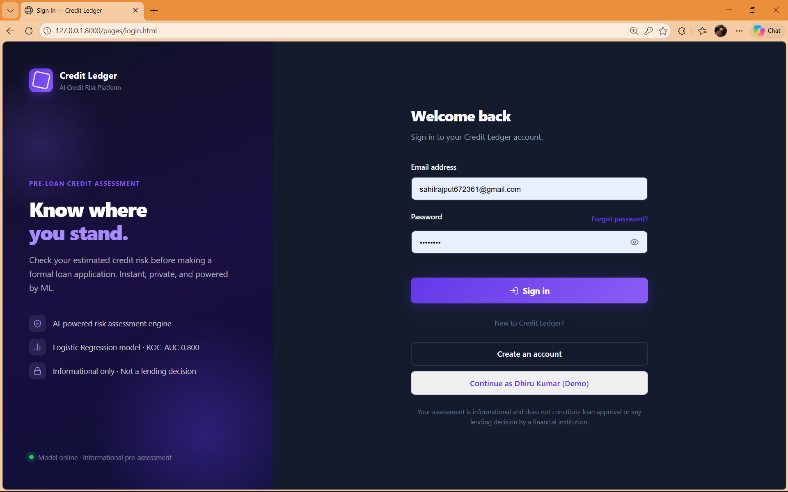
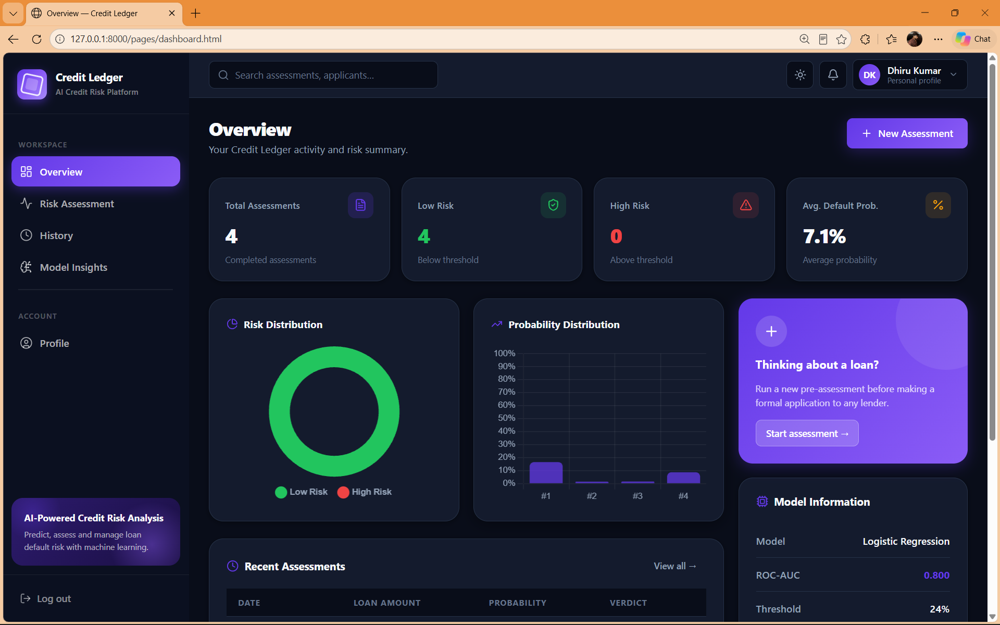
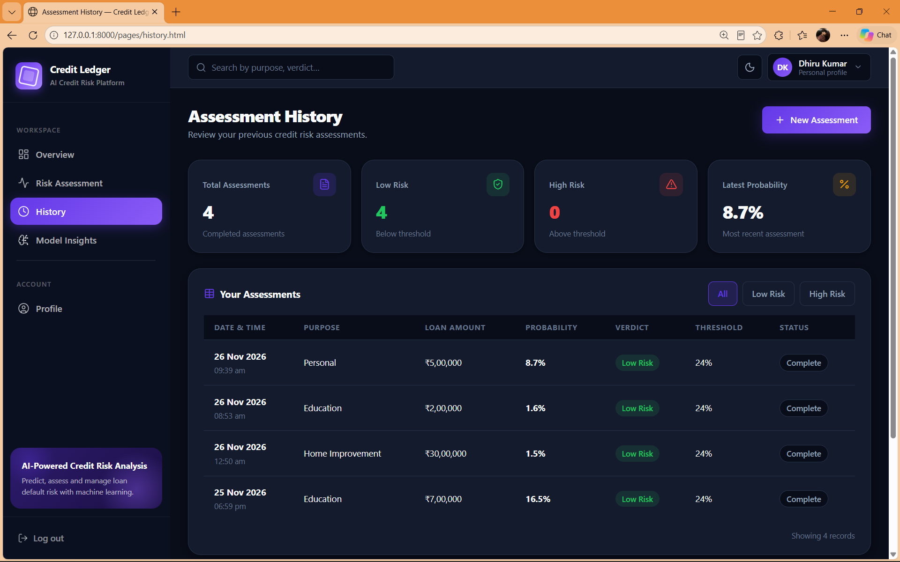
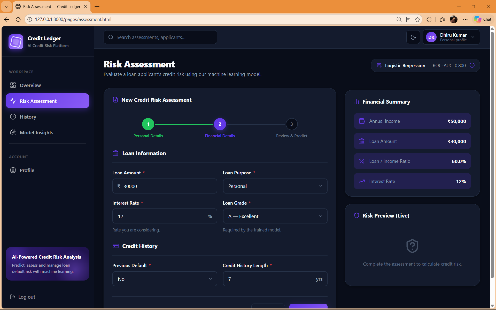
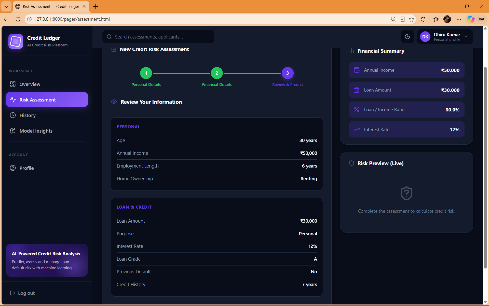
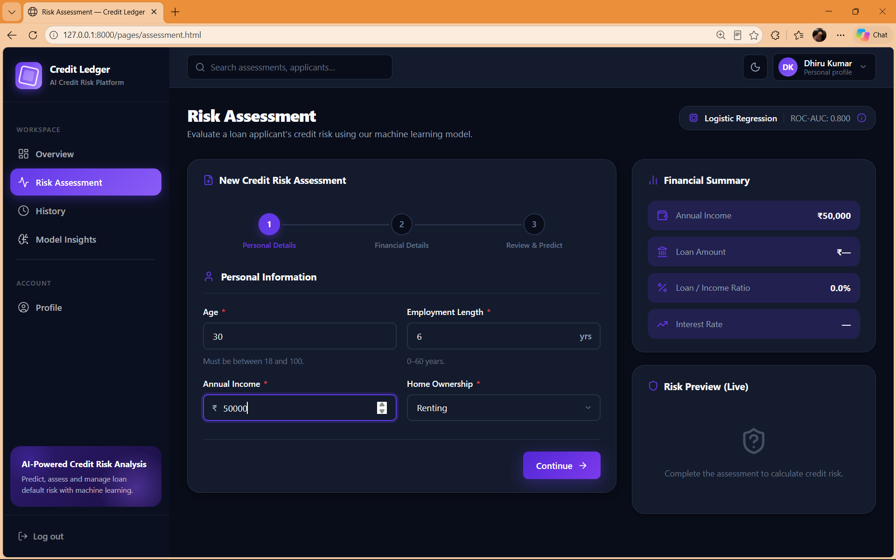

# Credit Risk Assessment — v4 (realistic synthetic data, rupees)

Predicts the probability that a loan applicant defaults. FastAPI backend + web UI.
## Project Screenshots














.png>)

## Quick start

```bash
python -m venv .venv && .venv\Scripts\activate     # Linux/Mac: source .venv/bin/activate
pip install -r requirements.txt
python generate_data.py    # optional: rebuilds data/credit_risk_dataset.csv (seeded, identical every time)
python train.py            # ~1 min: compares models, picks one, evaluates, saves models/
pytest -q                  # 15 tests
uvicorn main:app --reload  # UI at http://127.0.0.1:8000   API docs at /docs
```

## The dataset (read this first)

`data/credit_risk_dataset.csv` is **synthetic**: 60,000 simulated applicants generated by
`generate_data.py`. No real person's data is in it, and the rules inside it are my design
assumptions about retail credit, not fitted to any bank. The model's scores therefore show
how well it learns *those* rules plus noise; they do not prove real-world performance.
For real use, retrain on genuine historical loans.

Why it is more realistic than the old Kaggle-style file (`data/credit_risk_dataset_original.csv`, kept, unused):

| Property | Old file | This dataset |
|---|---|---|
| Default rate by loan/income | 29 % → **100 %** at exactly 30 % (a cliff; every renter above 30 % defaulted) | smooth: 5 % → 6 % → 8 % → 12 % → 16 % → 23 % → 35 % → 65 % |
| Default rate by grade | irregular | smooth: A 4.5 % … G 42.5 % |
| Overall default rate | 21.9 % | 11.0 % |
| Noise | almost none (AUC ~0.95) | realistic (AUC ~0.80) |
| Currency | dollar-like scale | rupees (income median ≈ ₹5.5 lakh, loans ₹10,000 – ₹30 lakh) |
| Missing values | few | employment length 3 %, interest rate 5 % |

Loan grade and interest rate are the *lender's own assessment* (a noisy proxy for bureau
score), not the cause of default. Full assumptions are documented in `generate_data.py`.

## Results (held-out test set: 12,000 applicants, used once)

| Metric | Value | Meaning |
|---|---|---|
| ROC-AUC | **0.800** | typical for real credit models (0.70–0.85) |
| Gini | **0.60** | 2 × AUC − 1 |
| KS | **0.46** | max separation of defaulters vs non-defaulters (>0.40 is good) |
| PR-AUC | **0.431** | a random model scores 0.109 |
| Brier | 0.079 | probabilities are well calibrated (see below) |
| Top 20 % riskiest scored | contain **60 %** of all defaulters | |

Selected model: **logistic regression** (chosen by 5-fold CV PR-AUC 0.438 vs XGBoost 0.434 tuned,
0.410 default). This is normal: credit scorecards are often logistic regression, and a simple
model is allowed to win here because the simulated risk is mostly additive. On messy real data
with interactions, boosted trees often gain a little; `train.py` will pick whichever wins.

**Calibration** (predicted vs actual default rate by risk decile): 1.5→2.3 %, 2.3→2.7 %, 3.1→3.7 %,
4.0→3.4 %, 5.2→4.4 %, 6.7→6.0 %, 8.9→9.6 %, 12.7→11.8 %, 20.6→19.7 %, 45.9→45.9 %.
A displayed "24 %" really means about 24 out of 100 such applicants default.

### Why "accuracy" is not the headline metric

Only 11 % of loans default, so predicting "nobody defaults" is already 89 % accurate.
At the chosen threshold the model has 87.1 % accuracy, *below* that useless baseline, because it
deliberately flags risky people and some flags are wrong. Judge a credit model by AUC / KS /
PR-AUC and by the precision-recall trade-off below, not by accuracy.

## Choosing the decision threshold (a business decision)

The default threshold (0.24) maximises F1 on out-of-fold training predictions. Move it by cost:

| Threshold | Accuracy | Precision | Recall (defaulters caught) | Flagged High Risk |
|---|---|---|---|---|
| 0.10 | 73.5 % | 25.1 % | 71.6 % | 31.2 % |
| 0.15 | 81.7 % | 32.3 % | 61.5 % | 20.9 % |
| 0.20 | 85.4 % | 37.8 % | 52.1 % | 15.1 % |
| **0.24 (default)** | **87.1 %** | **42.1 %** | **46.3 %** | 12.1 % |
| 0.30 | 88.8 % | 48.7 % | 38.8 % | 8.7 % |
| 0.50 | 90.0 % | 64.2 % | 19.6 % | 3.3 % |

Lower = catch more defaulters but reject more good customers. Change `THRESHOLD_BETA` in
`train.py` (beta > 1 favours recall) and retrain.

## Training rules

- Test set split off first and used exactly once.
- Model choice and threshold come only from cross-validation on the training set.
- No class weights, so probabilities stay honest.
- Impossible values become NaN instead of deleting rows.
- One artifact (`models/credit_risk_model.joblib`) holds model + threshold + features + library
  versions; the API warns if versions differ.
- `loan_percent_income` is derived identically in training and in the API.
- Two full retrains give byte-identical metrics.

## Safety layer in the API (`main.py`)

1. **Range warning:** any input outside the training range (e.g. a loan of ₹1 crore, or a loan
   larger than annual income) adds a note, shown under the result in the UI.
2. **Optional policy rule:** `MAX_LOAN_TO_INCOME` (default `None` = off). Set e.g. `0.8` to force
   High Risk for loans at or above 80 % of income, whatever the model says.

The API returns the model's own probability unchanged, plus `decision_source` and `notes`.

## What was wrong with v1 (all verified)

Shipped `.pkl` files didn't match the notebook; the shipped model had seen the test data
(AUC 0.977 vs honest 0.95); its threshold (0.29) gave only 58 % precision; the threshold was
tuned on the test set; the pickle couldn't load under the pinned scikit-learn; an `n_estimator`
typo; ~895 rows silently dropped; class weights distorted probabilities; the API accepted
impossible inputs. And the Kaggle-style data had an unrealistic 100 %-default cliff.

## Layout

```
generate_data.py      builds the synthetic dataset (documented assumptions)
train.py              CV model comparison -> threshold -> single test evaluation -> save
main.py               FastAPI app (POST /predict, GET /health, serves static/)
data/                 credit_risk_dataset.csv (used), credit_risk_dataset_original.csv (old, unused)
models/               credit_risk_model.joblib, metrics.json   (generated)
reports/              evaluation.png                           (generated)
static/               web UI
tests/test_api.py     15 tests
```

## API

`POST /predict` →
`{"default_probability": 0.095, "default_prediction": 0, "threshold": 0.24, "Result": "Low Risk", "decision_source": "model", "notes": []}`

`person_emp_length` and `loan_int_rate` may be omitted. `loan_percent_income` is ignored and
recomputed as `loan_amnt / person_income`.

## Caveats

- Synthetic data: demonstration only, not a lending model.
- The model uses age and home ownership. Real credit decisions need fairness testing,
  regulatory review, adverse-action explanations and drift monitoring.
